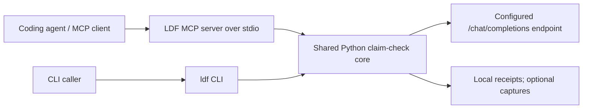
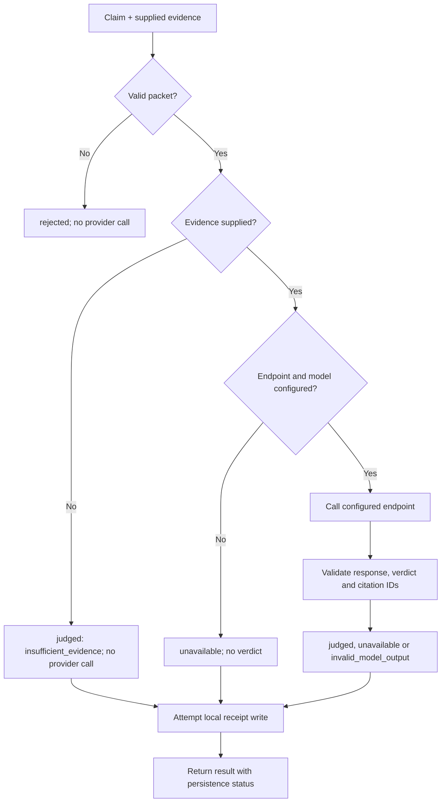

# Local Decision Framework

Evidence-grounded claim checks for coding agents and everyday operational work, through a shared Python core, CLI, and MCP server.

**Inspired by [Jev](https://docs.typesafe.ai/)** and its separation of context from judgement questions. This is an independent prototype; it does not require the TypeSafe API or claim equivalent model quality or wire compatibility.

## What it does

Give it one factual claim and a small evidence packet. It returns a cited verdict:

- `supported`
- `contradicted`
- `insufficient_evidence`

Operational failures and invalid model responses are separate from semantic verdicts. The tool cannot inspect files independently, prove causality or complete coverage, grant permission, or decide that an action is safe to execute.

Use it selectively for code/diff facts, debugging observations, requirement/report consistency, BAU status, document checks, and individual checklist items. Skip obvious facts, arithmetic, and checks already resolved by direct verification.

## How it works

An agent or CLI caller supplies a claim and bounded evidence. The shared Python
core validates the packet, calls the configured OpenAI-compatible endpoint when
needed, validates the verdict and citations, and attempts to write a local
receipt. The MCP server waits for tool requests; it does not check claims in the
background or discover and configure models automatically.



For a single claim with valid timeout and output settings:



Batch checks add receipt-based cache lookup before each independent check. Output
summaries and evidence retrieval use deterministic local code without model
calls. See [batch checks](#check-several-claims) and
[output evidence](#deterministic-output-evidence).

## Install

Requires Python 3.10+ and an OpenAI-compatible model endpoint.

```bash
git clone https://github.com/phillui-37/local-decision-framework.git
cd local-decision-framework
python3 -m venv .venv
.venv/bin/python -m pip install -e .
```

Or use `uv`:

```bash
uv venv .venv
uv pip install --python .venv/bin/python -e .
```

The package installs `ldf` and `ldf-mcp`, exposes the MCP tools listed below, and uses `LDF_*` settings with data under `~/.local/share/ldf`. For backward compatibility with existing integrations, the legacy `jev` / `jev-mcp` commands, the `jev` Python namespace, `JEV_*` environment variables (silently respected), and an existing `~/.local/share/jev` data directory continue to work. "Jev" in this repository refers only to this legacy naming and to the TypeSafe project credited above; this tool is unrelated to any hosted Jev service.

## Configure a model

No endpoint or model is selected automatically. Set them explicitly:

```bash
export LDF_BASE_URL=http://127.0.0.1:8000/v1
export LDF_MODEL=your-local-model
export LDF_OUTPUT_MODE=json_schema
# Optional authentication; do not put credentials in source or MCP arguments.
export LDF_API_KEY_FILE="$HOME/.config/your-runtime/api-key"

.venv/bin/ldf doctor --probe
```

`LDF_BASE_URL` includes `/v1`. A remote endpoint is also supported when you choose it explicitly; evidence will then be sent to that provider. There is no automatic model, provider, or output-format fallback.

| Setting | Purpose |
|---|---|
| `LDF_BASE_URL`, `LDF_MODEL` | Required endpoint and model ID |
| `LDF_API_KEY_FILE` or `LDF_API_KEY` | Optional provider authentication |
| `LDF_OUTPUT_MODE` | `json_schema`, `json_object` (default), or `plain` |
| `LDF_TIMEOUT` | Per-call timeout, 1–300 seconds; default 90 |
| `LDF_MAX_OUTPUT_TOKENS` | Output budget, 1–8192; default 2400 |
| `LDF_REASONING_EFFORT` | Optional provider-specific setting |
| `LDF_DATA_DIR` | Private receipt/capture storage; default `~/.local/share/ldf` (falls back to a legacy `~/.local/share/jev` if present) |

Every `LDF_*` setting also accepts its legacy `JEV_*` spelling, so existing configurations keep working unchanged.

Use a mode supported by your backend. Schema-constrained output still passes local strict validation; JSON validity and valid citations do not establish judgement correctness.

The completion-token budget and the 1200-character rationale limit are separate.
Prompt v3 requests 1–3 short sentences, preferably under 400 characters. Raising
`LDF_MAX_OUTPUT_TOKENS` does not relax local validation or make a truncated
response usable. See [troubleshooting](#troubleshooting) for output-budget issues.

## Check a claim

```bash
printf '%s\n' '{
  "claim": "The supplied run recorded no failures.",
  "evidence": [
    {"id": "run", "text": "Requests: 1000; failed requests: 2."}
  ],
  "flow": "direct"
}' | .venv/bin/ldf judge
```

Evidence blocks have a unique `id`, nonblank `text`, and optional `scope` and `source`. Locators are labels, not resources the tool fetches. Flows are `direct` and `evidence-first`.

Illustrative response, not a recorded model run (IDs and timing vary):

```json
{
  "status": "judged",
  "request_id": "example-receipt-id",
  "duration_ms": 1000,
  "persistence": "recorded",
  "verdict": "contradicted",
  "evidence_ids": ["run"],
  "rationale": "The supplied run records two failed requests."
}
```

`status` describes processing; `verdict` answers the claim. `contradicted` is a
successful check that disagrees with the claim, not a connection failure.
`evidence_ids` cites IDs from your input. Only `status=judged` carries a usable
single-claim verdict. `unavailable`, `invalid_model_output`, and `rejected` provide
none. Review consequential conclusions against their sources.

**CLI exit codes:** handled semantic and operational results currently return
exit code 0, including `contradicted`, `rejected` and `unavailable`. Parse the JSON
`status` and `verdict`; do not use `$?` as the judgement or health result.
Argparse usage errors exit 2; an uncaught runtime failure can exit nonzero.
Likewise, `doctor --probe` checks the models endpoint, not a complete judgement.

## Check several claims

Use `ldf judge-claims` or MCP `ldf_check_claims` for 1–8 independent claims against
at most 12 shared evidence blocks. Claim IDs must be unique within the batch.
Misses are checked sequentially; one batch is not one combined model judgement.

```sh
printf '%s\n' '{
  "claims": [
    {"id": "requests", "claim": "The run recorded 1000 requests."},
    {"id": "failures", "claim": "The run recorded no failures."}
  ],
  "evidence": [{"id": "run", "text": "Requests: 1000; failed requests: 2."}],
  "flow": "direct"
}' | .venv/bin/ldf judge-claims
```

The result has `status: "battery"`, `battery_hash`, a numeric `cached` count and
`results` in input order. Each result identifies `claim_id`, `request_id` and
`cached`. Uncached entries have their own `status`; a judged entry also has a
verdict and citations. A provider failure for one claim does not make the whole
batch supported or prevent later claims from being attempted. Invalid batch
input is rejected before the loop.

Previously judged matching inputs can return cached verdicts without another
model call. Cached entries currently omit `status` and can lack citations and
rationale retained by the original response. There is no TTL or automatic
model/settings invalidation. For a fresh cited check, use the single-claim tool
or `ldf judge`. Read the [batch/cache contract](docs/observability-replay.md#batch-results-and-cache)
before using batches in an automated decision path.

## Troubleshooting

| Symptom | Check / action |
| --- | --- |
| Missing endpoint/model, failed probe or authentication | Set `LDF_BASE_URL` including `/v1` and the exact model ID. Check the configured key file is readable. `doctor --probe` expects the model in `/models`; a backend that omits that endpoint can fail the probe even if chat works. Inspect `error_code` and receipt diagnostics without printing credentials. |
| Provider rejects structured output | Explicitly select a backend-supported `LDF_OUTPUT_MODE`: `json_schema`, `json_object`, or `plain`. The tool never changes provider or format automatically; plain output still passes strict local validation. |
| Timeout or truncated/invalid output | Inspect the receipt's failure/finish diagnostics. Adjust `LDF_TIMEOUT` (1–300 seconds) for latency or `LDF_MAX_OUTPUT_TOKENS` (1–8192) for completion budget. The rationale limit remains 1200 characters. Retry deliberately; a partial result has no usable verdict. |


## MCP and Skills

Register this stdio server in your client, replacing the paths and model settings:

```json
{
  "mcpServers": {
    "local-decision-framework": {
      "command": "/absolute/path/to/local-decision-framework/.venv/bin/ldf-mcp",
      "args": [],
      "env": {
        "LDF_BASE_URL": "http://127.0.0.1:8000/v1",
        "LDF_MODEL": "your-local-model",
        "LDF_OUTPUT_MODE": "json_schema"
      }
    }
  }
}
```

The server exposes four tools:

| Tool | Purpose |
| --- | --- |
| `ldf_check_claim` | One factual claim, with a fresh check against supplied evidence |
| `ldf_check_claims` | Up to eight independent claims sharing evidence, with receipt-based cache reuse |
| `ldf_summarize_output` | Deterministic summary of a registered output source |
| `ldf_fetch_evidence` | Bounded original lines from a registered source |

Client-qualified names may vary. For existing integrations, the legacy `jev-mcp`
command launches the same server. Use the CLI to register output sources first.

[SKILL.md](SKILL.md) teaches when to call it across coding and BAU tasks, how to prepare bounded evidence, and when to abstain. Install it through your agent's Skill mechanism and set its CLI fallback path for your machine. Invocation stays optional and advisory.

## DSH integration

For DSH, use the separate [dsh-ldf host plugin](https://github.com/phillui-37/dsh-ldf).
It runs a pinned copy of this repository as a Git submodule through DSH's native
MCP client. Its DSH adaptation includes a settings form, editable prompt guidance,
connection lifecycle management, and the on-demand `ldf_discover_models` and
`ldf_setup_local_model` tools. These two host tools belong to the plugin; this
repository's MCP server exposes the four tools listed above.

The plugin supports local model discovery and approved setup for Ollama and
LM Studio. Setup requires approval of the exact runtime, model and format. The
standalone LDF core requires an explicitly configured endpoint and model.

Follow the plugin's [setup instructions](https://github.com/phillui-37/dsh-ldf#setup)
and [settings reference](https://github.com/phillui-37/dsh-ldf#settings) for DSH
installation, Python interpreter paths and host-specific defaults. The plugin
supplies its own settings, including timeout and output budget, so its defaults
can differ from the standalone defaults documented here. Its pinned upstream
revision also determines which LDF changes are available in DSH.

## Receipts, replay and feedback

Receipts contain timing, versions, model/settings fingerprints, input hashes and safe response diagnostics. Inputs and raw responses are not retained by default.

```bash
# Explicitly capture this debugging request and its raw response locally.
LDF_CAPTURE_RESPONSE=1 .venv/bin/ldf judge --capture < packet.json

.venv/bin/ldf receipts show RECEIPT_ID
.venv/bin/ldf replay RECEIPT_ID --mode original --expected contradicted
.venv/bin/ldf replay RECEIPT_ID --mode current --expected contradicted

.venv/bin/ldf feedback add RECEIPT_ID contradicted \
  --kind human --reason "Checked against the original result."
.venv/bin/ldf issue list
```

Original replay checks the saved response offline. Current replay makes a new configured-model call and links its receipt to the original. Missing inputs cannot be recovered from a hash. Agent-test feedback is distinct from actual human review; a successful replay is required before an issue can be marked regression-tested.

See [observability and replay](docs/observability-replay.md) and [wider scenario usage](docs/scenario-pilot.md). The [empty usage-review template](examples/usage-review.template.json) can hold manual observations alongside a receipt.

## Development

The tests use synthetic unit-test mocks and local HTTP servers; they require no live model or credentials.

```bash
.venv/bin/python -m pip install -e .
PYTHONPATH=src .venv/bin/python -m unittest discover -s tests -v
```

This public repository contains framework code, unit tests, usage documentation, and the distributable Skill. Training/evaluation datasets, benchmark recordings, real request data, captures, receipts, agent conversation records, and private research history are excluded from Git and distribution artifacts.

## Prototype limits

This is an experimental decision aid. Model and scenario quality must be evaluated separately from protocol validity and replay reproducibility. Choice, routing, ranking, automatic runtime hooks, cross-model consensus, and compatibility with the hosted Jev protocol are not implemented. No general accuracy, calibrated-confidence, or autonomy claim is made.

## Deterministic output evidence

Register test/build/log output with `ldf source register <path>` (or `-` for stdin), inspect it using `ldf source summarize <ref_id>`, then retrieve numbered details with `ldf source fetch <ref_id> --lines N:M` or `--errors first=K|all`. Summaries name their detection scope and separate source-wide counts from displayed events; they never prove absence. Hash changes are reported as `stale_source`. See [docs/evidence-layer.md](docs/evidence-layer.md).
